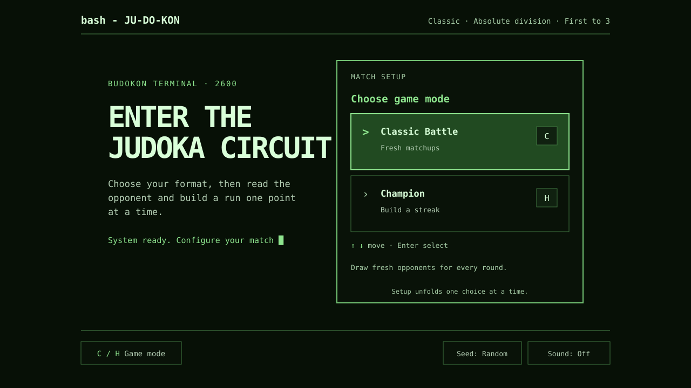

# judokon-2600

[](https://github.com/CyanAutomation/judokon-2600/actions/workflows/ci.yml) [](https://github.com/CyanAutomation/judokon-2600/actions/workflows/codeql.yml)

A terminal-style, text-first TypeScript implementation of JU-DO-KON! Classic Battle.

**Players:** [Play the game online](https://judokon-2600.vercel.app/). **Developers and contributors:** follow [Getting started](#getting-started) and the [developer guide](docs/index.md).



## Getting started

Requires Node.js `>=24.15.0 <25` (the repository includes an `.nvmrc` file).

```sh
npm ci
npm run dev
```

Open [http://localhost:5173](http://localhost:5173) to play locally. The Vite development server supports gameplay and deterministic match summaries, but it does not run the Vercel tactical-assessment function. To manually test tactical insight, use a configured Vercel Preview; the [deployment guide](docs/tactical-insight-deployment.md) covers the required Firewall rule and environment variables. See the [developer guide](docs/index.md) for the repository map and additional setup details.

## Gameplay

### Setup and scoring

Setup unfolds in four steps:

- Choose a mode: **Classic** or **Champion**.
- Choose a division: **Absolute** open-weight or **Weight** class. Weight division offers the 14 catalogue classes `-48`, `-52`, `-57`, `-60`, `-63`, `-66`, `-70`, `-73`, `-78`, `-81`, `-90`, `-100`, `+78`, and `+100`.
- Choose a match length: **Quick** (first-to-3), **Medium** (first-to-5), or **Long** (first-to-10).
- Start the match. With no saved preferences, setup defaults to Classic, Absolute, Random weight class, and Quick (first-to-3).

A selected stat is compared with the opponent's hidden value; the higher value earns a point. A match ends when a side reaches its target or after 25 rounds.

### Keyboard controls

- During setup, choose a mode with `C` (**Classic**) / `H` (**Champion**) and a division with `A` (**Absolute**) / `W` (**Weight**). Cycle match length with the arrow keys or `1`–`3`; if you chose Weight division, confirm its class with `Enter`, then confirm match length with `Enter` or `Space` to start.
- During a match, choose a stat with `1`–`5` (`power`, `speed`, `technique`, `kumikata`, `newaza`). Press `Enter` or `Space` to advance or replay, and quit with `Esc` or `Q`.
- Stat choices display as **Power**, **Speed**, **Technique**, **Kumi-kata**, and **Ne-waza**.
- Optional keyboard ticks and outcome beeps are available in **Advanced options**. They are muted by default and the preference is stored in `localStorage`. When enabled, keyboard actions and match outcomes play audio feedback; muting suppresses new feedback.

### Match summary and Champion mode

After each match, the summary recommends your best stat by most rounds won, then highest win rate, then earliest position in the displayed order (`power`, `speed`, `technique`, `kumikata`, `newaza`). It reports both wins and total selections; if no stat won a round, no recommendation is shown.

In **Champion** mode, you keep the same judoka while opponents rotate. The **Current streak** counts consecutive rounds won at the end of the run: each win extends it, while either a loss or a draw resets it to zero. Earlier wins remain part of the run record but do not count toward the current streak.

### Tactical insight

An optional post-match tactical insight interprets patterns in the player’s choices. The browser sends compact counts and outcome patterns to the same-origin `/api/tactical-assessment`; it does not send judoka IDs, stat values, replay seeds, local storage, or hidden opponent values. Application code assembles the insight text and omits low-confidence results; JEV supplies typed scores only. The deterministic summary remains authoritative, and the match remains playable when the optional insight is unavailable. On Vercel, configure `OPENROUTER_API_KEY` and `JEV_ASSESSMENT_RATE_LIMIT_ID`; `JEV_MODEL` optionally overrides the default `~typesafe/jev-latest`. See the [tactical insight deployment guide](docs/tactical-insight-deployment.md) for Firewall setup and verification.

### Opponents, replay, and connection issues

Judoka are fetched directly from the public [Budokon catalogue API](https://budokon.scheimann.workers.dev/docs). Before each match, six judoka are drawn into a buffer so subsequent opponents can appear instantly. The seed button in the footer **Advanced options** bar opens a dialog for an optional replay seed; otherwise each match gets a fresh seed. **Replay** starts a fresh match with the active seed and reproduces the same draws only while the Budokon dataset version and draw algorithm stay the same. The API returns both values, but this client does not retain them with the replay seed. Draw requests time out after 10 seconds. Connection failures, rejected access, missing endpoints, timeouts, and temporary server failures display retry guidance in the status area.

### Saved sessions and scout report

Reloading the same browser tab restores the last valid saved session, including its match, result, round history, replay seed, active weight class, and prefetched judoka. Only stable match states are saved: an in-progress stat selection and optional tactical assessment are not persisted. With no valid saved session, the app opens in setup.

While a round is open, a scout report shows the opponent's strongest stat (all tied stats when there is a tie). The opponent's exact values remain hidden until you select a stat.

## Roadmap

Possible future features and their design constraints are collected in the [project roadmap](docs/roadmap.md). These proposals are not part of the current game.

## Development and checks

Run the complete local quality gate with:

```sh
npm run check
```

This runs lint, tests, local Markdown link and style checks, and the production build. The build compiles with `tsc -p tsconfig.app.json` then produces the bundle with `vite build`.

To run the documentation checks on their own:

```sh
npm run docs:check
```

Generate coverage-backed health metrics with:

```sh
npm run fallow:coverage
```

This runs the test suite with coverage, then runs Fallow with the generated Istanbul report for exact CRAP scores. Fallow also treats `api/**/*.ts` as Vercel function entry points.

The behavior IDs used by UI and game tests are documented in [Test behavior contracts](docs/test-contracts.md).

## Contributing and support

Report bugs or suggest changes through [GitHub Issues](https://github.com/CyanAutomation/judokon-2600/issues). For larger changes, open an issue first to discuss the approach. Pull requests should include relevant tests; when user-visible behavior changes, update the matching [test behavior contract](docs/test-contracts.md). Run `npm run check` before submitting.

## License

This project is distributed under the GNU General Public License v3.0. See [LICENSE](LICENSE) for the full license text.

## Vercel deployment

`vercel.json` configures Vercel to run `npm run check` before publishing Vite's `dist` output. This runs lint, tests, local Markdown link and style checks, and the production build in the deployment itself, so a failed quality check blocks the deployment. In Vercel, import `CyanAutomation/judokon-2600` and enable its Git integration. Pushes to `main` create production deployments; pull requests create preview deployments. The separate GitHub Actions workflow runs the same gate on every pull request and on pushes to `main`.
